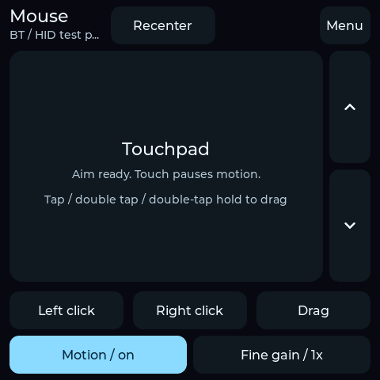
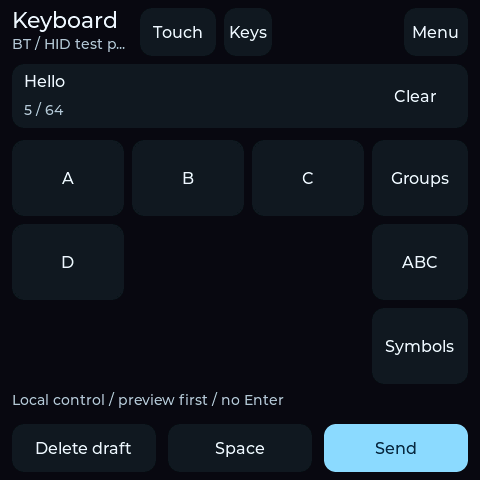
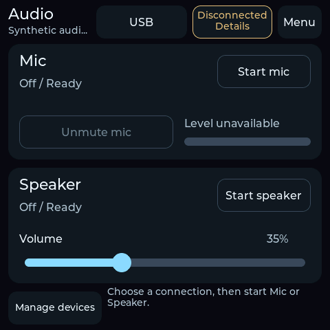

# ESP32-INPUT

ESP32-INPUT has two firmware targets: ESP-Mosaico (ESP32-S31) and FoloToy
AI Passport (ESP32-C3). Both send standard Bluetooth mouse and keyboard
input and expose board-hosted browser and API control. The target device
needs no companion application or computer relay.

Mosaico turns an ESP-Mosaico into a handheld air mouse,
touchpad and keyboard, with microphone and speaker controls on the same
touchscreen. Rotate to aim, use touch for fine movement, or compose and review
text before sending it. USB and Bluetooth use standard HID, so basic input
needs no companion app on the target phone, tablet or computer.

You can also drive Mosaico from a web browser, an HTTPS API or an AI assistant
through the MCP companion. It brings the same mouse and keyboard controls to
an iPad, iPhone or computer while you watch that device's screen separately.
Use it as a handheld remote, a browser touchpad or a physical input bridge for
automation.

| Mouse | Keyboard | Audio |
| :---: | :---: | :---: |
|  |  |  |
| Rotate to aim or use the touchpad, wheel and drag controls. | Compose with touch, motion or confirmed spoken letters. | Choose USB or Bluetooth and control Mic and Speaker independently. |

[UI previews](docs/ui/README.md) show Mosaico and Passport layouts from
host-rendered LVGL and browser fixtures.

## FoloToy AI Passport

Passport uses its 240 × 320 screen and three buttons for a directional mouse,
click, Esc, Enter, Tab, Backspace, arrow keys, connection management, and
Lock. The local Bluetooth page lists saved hosts and supports pairing,
disconnecting, selecting a saved host, and confirmed removal. The local Wi-Fi
page lists saved and scanned networks. To enter a router password, open the
temporary Passport Wi-Fi setup page from a phone or computer and confirm the
exact request on the device; no password typing is required on three buttons.

Passport normally joins a 2.4 GHz LAN and shows its IP. If it cannot join,
it starts its own password-protected Wi-Fi network and displays connection
details and QR codes. Visit the displayed board address to use its responsive
mouse, keyboard, and connections page on a computer, iPhone, or iPad. Agents
can send the same input through the board's HTTP/WebSocket API. Its browser
and device interfaces each offer Dark and Light themes. Passport network
input is open to anyone who can reach its HTTP listener; use its on-device
Lock when remote input should stop.

Passport retains BLE HID and optional local speaker cues, which start Off.
It has no native USB HID, motion sensor input, touch input, microphone,
Bluetooth audio, or media workflow. Its USB Serial/JTAG port also exposes a
local command API for automated Wi-Fi, Bluetooth, mouse, keyboard and settings
control; it remains a serial protocol, not USB HID. Source, host, browser and
ESP32-C3 builds pass, and bounded tests on one Passport cover BLE HID input,
USB control, AP/DHCP and unattended LAN health. Sustained Web reliability and
broader phone, tablet and computer compatibility remain to be qualified.
[Passport setup, build, and validation](passport/README.md) ·
[Passport API](passport/API.md) ·
[Passport USB control](docs/passport-usb-control.md) ·
[Community release requirements](docs/passport-community-release.md)

## Control an iPad or iPhone

1. **Connect ESP32-INPUT.** On Mosaico, choose Bluetooth input and open
   **Bluetooth devices → Mouse & Keyboard → Add device**. Pair the device
   ending in `-IN` on your iPad or iPhone. Enable **Settings → Accessibility
   → Touch → AssistiveTouch** for pointer control, or ask Siri to
   “Turn on AssistiveTouch.” On USB-C models, you can instead connect Mosaico
   directly with a USB-C data cable and select USB input. Bluetooth leaves
   the Apple device's port free for screen capture on a Mac.
   [Pointer setup](https://support.apple.com/en-gb/111775)

2. **View the screen on a Mac.** Connect the unlocked iPad or iPhone over
   USB, trust the Mac, then open QuickTime Player → **File → New Movie
   Recording**. Choose the device in the source menu next to Record; the
   preview works without starting a recording. For a still image, send
   `⌘⇧3` from the ESP keyboard on iPad, or use Siri or AssistiveTouch to take
   a screenshot on iPhone. Save it to Photos, then import it with Image
   Capture. Scripts can use `afcclient` over trusted USB to retrieve a new
   screenshot, as verified on iPad.
   [QuickTime](https://support.apple.com/en-gb/guide/quicktime-player/qtp356b55534/mac) ·
   [Image Capture](https://support.apple.com/guide/image-capture/image-capture-imgcp1003/mac) ·
   [libimobiledevice](https://github.com/libimobiledevice/libimobiledevice)

3. **Send input from the web or an AI client.** Open the HTTP address
   shown in Mosaico **Settings → Wi-Fi → Web/API**. Authorize your browser
   with the code shown there, check the intended input target, and choose
   **Take control**. The web page provides a touchpad and keyboard. Scripts
   and AI clients can send input through the HTTPS API or MCP companion.
   View the screen separately using step 2.
   [Browser controls](docs/browser-controller.md) · [API and MCP](docs/automation.md)

4. **Use Siri for on-device actions.** Ask Siri on the iPad or iPhone to
   open an app or run a Shortcut you've already set up. Use the ESP pointer
   to continue from the screen you can see.
   [Run Shortcuts with Siri](https://support.apple.com/guide/shortcuts/run-shortcuts-with-siri-apd07c25bb38/ios)

See the [iPhone and iPad guide](docs/user-guide.md#control-an-ipad-or-iphone)
for setup details and the [automation workflow](docs/automation.md#ipad-and-iphone-control)
for combining input with a separate screen source.

## Mosaico hardware and status

- **Board:** ESP-Mosaico (ESP32-S31), with a USB-C data connection or Bluetooth.
- **Input:** Standard relative mouse and keyboard HID. The target uses a US ANSI
  layout for text and may need accessibility settings for pointer use.
- **Browser, API and AI control:** Use a phone browser, an HTTPS client or an
  MCP-capable AI assistant to send mouse and keyboard input to the selected
  target over the LAN or its persistent control hotspot. Mosaico retains its
  enrolled HTTPS authorization on both networks. Its control interface also
  supports sensor export and signed update staging.
  [Try the control workflows](docs/automation.md)
- **Validation:** Pinned target builds and host regressions have passed at
  documented checkpoints. A brief Windows test passed with Bluetooth playback,
  touchpad input and Motion operating together. Fast-motion response, repeatable
  saved audio reconnect and sustained audio quality still need qualification.
  iPhone, iPad, Windows and macOS are compatibility targets.
  [Validation and known issues](docs/validation.md)

## Get started

- [User guide](docs/user-guide.md) for connecting a host and using the workspaces.
- [Build and recovery guide](firmware/README.md) for SDK setup, target builds,
  flash layout and device recovery.
- [Passport guide](passport/README.md) for ESP32-C3 setup, local controls,
  network control, and its separate build.
- [API reference](docs/remote-control.md) for enrollment, transport and command
  semantics. See the [companion guide](bridge/README.md) for MCP and release tools.
- [Architecture](docs/architecture.md) and [board porting](docs/porting.md)
  for code ownership and hardware boundaries.

To compile the Mosaico target from a clone, install Git, a C compiler with
sanitizers, and Python 3.11 or newer. Run from the repository root, using
the installed Python version in the setup command:

```sh
python3.12 tools/idf.py setup
python3 tools/idf.py build
```

The helper initializes the pinned BSP and installs the SDK and tools locally.
It never opens a device. A board with the factory partition table requires a
separate, backed-up migration before it can run this firmware. Follow the
[device procedure](firmware/README.md#device-procedure) before writing flash.


## Repository layout

| Path | Contents |
| --- | --- |
| [firmware/](firmware/) | ESP32-S31 Mosaico application, board adapters and configuration |
| [passport/](passport/) | ESP32-C3 Passport application, board adapters, Web assets and configuration |
| [components/](components/) | Portable input, audio, settings and protocol logic |
| [api/](api/) and [bridge/](bridge/) | Versioned API definitions and host companion |
| [docs/](docs/) | User guides, interface contracts and validation results |
| [tests/](tests/) and [tools/](tools/) | Host regressions, build helpers and diagnostic collectors |
| [patches/](patches/) and [third_party/](third_party/) | Pinned SDK patches and upstream BSP |

Start with [validation procedures](docs/test-coverage.md) for test commands
or the [diagnostics guide](firmware/README.md#opt-in-diagnostics) for the
available build options.

## Developer

ESP32-INPUT is developed and maintained on GitHub by
[from1to9](https://github.com/from1to9). The canonical source repository is
[from1to9/ESP32-INPUT](https://github.com/from1to9/ESP32-INPUT).
The device's About screen reports the project attribution and build identity.
See [firmware attribution](docs/build-identity.md) for the fields and how they
are generated.

## Contributing and license

See [Contributing](CONTRIBUTING.md) for checks and patch guidance, [Security](SECURITY.md)
for private reporting, and the [roadmap](docs/roadmap.md) for development goals.
Original project code and documentation are under [Apache-2.0](LICENSE).
See [NOTICE](NOTICE) and [dependency provenance](docs/references.md) for upstream terms.
