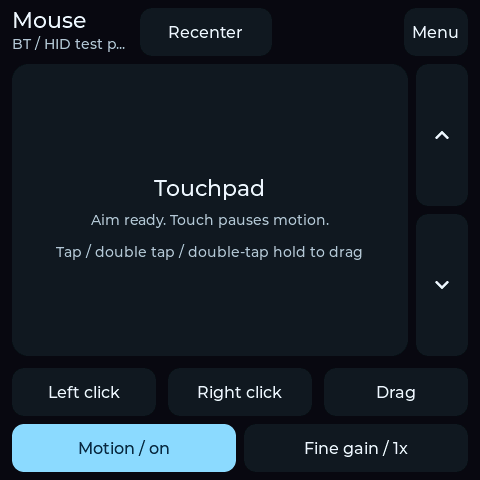
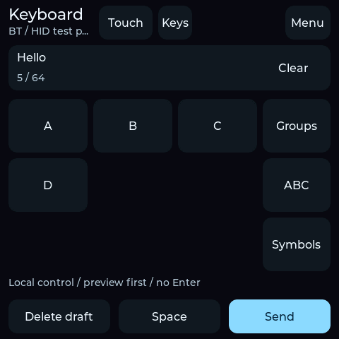
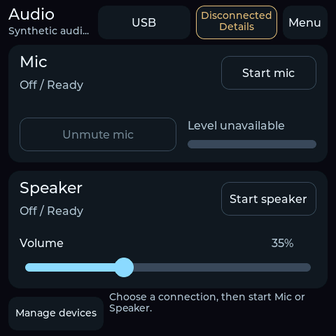

# ESP32-INPUT

ESP32-INPUT turns an ESP-Mosaico (ESP32-S31) into a handheld mouse and
keyboard. Use the touchpad for fine movement or rotate the device to aim.
The on-device keyboard lets you compose and review text before sending it.
USB and Bluetooth use standard HID, so basic input needs no companion app
on the target host.

| Mouse | Keyboard | Audio |
| :---: | :---: | :---: |
|  |  |  |
| Rotate to aim or use the touchpad, wheel and drag controls. | Compose with touch, motion or confirmed spoken letters. | Choose USB or Bluetooth and control Mic and Speaker independently. |

[Device UI and interaction](docs/ui/README.md) shows the layout from host-rendered
LVGL fixtures.

## Hardware and status

- **Board:** ESP-Mosaico (ESP32-S31), with a USB-C data connection or Bluetooth.
- **Input:** Standard relative mouse and keyboard HID. The target uses a US ANSI
  layout for text and may need accessibility settings for pointer use.
- **Browser, API and AI control:** Use a phone browser, an HTTPS client or an
  MCP-capable AI assistant to send mouse and keyboard input to the selected
  target. The LAN interface also supports sensor export and signed update staging.
  [Try the control workflows](docs/automation.md)
- **Validation:** Pinned target builds and host regressions have passed at
  documented checkpoints. A brief Windows test passed with Bluetooth playback,
  touchpad input and Motion operating together. Fast-motion response, repeatable
  saved audio reconnect and sustained audio quality still need qualification.
  iPhone, iPad, Windows and macOS are compatibility targets.
  [Validation and known issues](docs/validation.md)

## Get started

- [User guide](docs/user-guide.md) for connecting a host and using the workspaces.
- [Build and recovery guide](firmware/README.md) for SDK setup, target builds,
  flash layout and device recovery.
- [API reference](docs/remote-control.md) for enrollment, transport and command
  semantics. See the [companion guide](bridge/README.md) for MCP and release tools.
- [Architecture](docs/architecture.md) and [board porting](docs/porting.md)
  for code ownership and hardware boundaries.

To compile from a clone, install Git, a C compiler with sanitizers, and
Python 3.11 or newer. Run from the repository root, using the installed
Python version in the setup command:

```sh
python3.12 tools/idf.py setup
python3 tools/idf.py build
```

The helper initializes the pinned BSP and installs the SDK and tools locally.
It never opens a device. A board with the factory partition table requires a
separate, backed-up migration before it can run this firmware. Follow the
[device procedure](firmware/README.md#device-procedure) before writing flash.


## Repository layout

| Path | Contents |
| --- | --- |
| [firmware/](firmware/) | ESP32-S31 application, board adapters and configuration |
| [components/](components/) | Portable input, audio, settings and protocol logic |
| [api/](api/) and [bridge/](bridge/) | Versioned API definitions and host companion |
| [docs/](docs/) | User guides, interface contracts and validation results |
| [tests/](tests/) and [tools/](tools/) | Host regressions, build helpers and diagnostic collectors |
| [patches/](patches/) and [third_party/](third_party/) | Pinned SDK patches and upstream BSP |

Start with [validation procedures](docs/test-coverage.md) for test commands
or the [diagnostics guide](firmware/README.md#opt-in-diagnostics) for the
available build options.

## Developer

ESP32-INPUT is developed and maintained on GitHub by
[from1to9](https://github.com/from1to9). The canonical source repository is
[from1to9/ESP32-INPUT](https://github.com/from1to9/ESP32-INPUT).
The device's About screen reports the project attribution and build identity.
See [firmware attribution](docs/build-identity.md) for the fields and how they
are generated.

## Contributing and license

See [Contributing](CONTRIBUTING.md) for checks and patch guidance, [Security](SECURITY.md)
for private reporting, and the [roadmap](docs/roadmap.md) for development goals.
Original project code and documentation are under [Apache-2.0](LICENSE).
See [NOTICE](NOTICE) and [dependency provenance](docs/references.md) for upstream terms.
