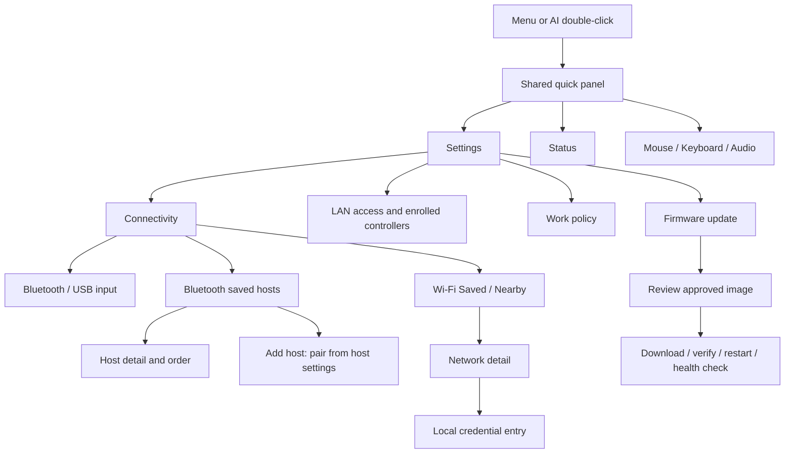

# Connection management and firmware update UI

Status: proposed next phase, 2026-10-21. The production UI at `d9e39ea9406e75cfdb318877d98801d3442fd07b` remains frozen until the baseline target/device gate. Complete the full device API function plan before implementing any new interface. This document changes no production code and does not claim that the proposed services are implemented or qualified.

The governing behavior is in [requirements](../docs/requirements.md), especially "Connection management and firmware updates", and the [remote-control contract](../docs/remote-control.md). Use the [focused-workspace layout and shared quick panel](ui-plan.md), which the latest user instruction explicitly authorizes in place of persistent tabs/header. Network, Bluetooth, settings and update managers own capabilities, admission, progress and durable state; this document specifies their local presentation. The [Wi-Fi management/OTA service draft](../docs/wifi-management-ota.md) supplies the scan/profile, staging and recovery contract. Latest owner decisions on unattended authorization and the three work policies take precedence over older draft wording; remaining cross-document reconciliation is listed below.
The latest native setup extension is specified in [Native Wi-Fi UI](native-wifi-ui.md): the device scans and joins the existing LAN locally; the computer stays on its own Wi-Fi. SoftAP is explicit recovery only. That scoped extension retains the actual single saved-network capability and a shared local editor for Wi-Fi credentials and the local Bluetooth device name. The broader profile/remote-service/OTA pages below remain capability-dependent plans.

## 1. Three independent choices

| Choice | User-facing control | Meaning |
| --- | --- | --- |
| Input transport | Bluetooth / USB | One shared selection for Mouse, Keyboard and Audio. Capability and readiness remain specific to each function. A change never duplicates input or enables unsupported audio. |
| Saved connection order | Wi-Fi network order; Bluetooth target order | Preference for future reconnection or supported host-admission windows. These are two separate lists. Ordering alone does not interrupt a healthy connection. |
| Work policy | Input-first / Balanced / Management-first | Scheduling of bounded application background work while input and management coexist. Input-first is the default. This is neither an input-transport switch nor a promised radio time allocation. |

Wi-Fi remains a simultaneous management/control channel for LAN state, authenticated API access, MCP bridge access and approved firmware downloads. Wi-Fi association does not establish Internet reachability, an authenticated controller, a control lease or an operational MCP bridge. Bluetooth remains a host-initiated HID connection in the initial peripheral implementation.

Do not add a Wi-Fi/Bluetooth toggle, RF percentage slider, Bluetooth signal meter, arbitrary advertisement Connect button or unqualified performance promise. Work-policy choices become actionable only when a manager reports a supported, tested implementation; they cannot merely change a label.

## 2. Navigation and 480 x 480 geometry

Menu and physical AI double-click open the same quick panel. It contains mode cards, the actual selected-input target/connection summary, Status, Settings and Close. A compact BT/USB plus target cue remains under the mode title; routine battery/Wi-Fi details are on demand. No edge-swipe navigation crosses the mouse pad. [UI plan](ui-plan.md) owns exact primary/quick-panel geometry and the safe page lifecycle.

All connection-management entry paths are Quick panel -> Settings -> Connectivity/Management/Work policy/Firmware update, with Status as the read-only overview. Use the shared 480 x480 shell: title/Close in the first56 px, content x12/y64/w456/h344, and parent navigation x12/y424/w456/h48. Page longer forms/lists instead of retaining the old persistent telemetry header or reducing target sizes. Body text is16 px, metadata14 px and titles22 px; actionable targets are at least44 x44. Proposed next-phase services remain capability-gated and await complete API planning.

Saved/Nearby lists use two224 x44 tabs at x12/x244, y64; four456 x52 rows at y120/y180/y240/y300; and a44 px paging strip at y364. Paging uses x12/w144, center x168/w144 and x324/w144. A row has a primary name, secondary state and an optional trailing icon; its entire52 px area opens details. A selected row has a border and text marker, not color alone. The footer offers at most two224 x48 actions. More actions belong on a detail page.

Use a stable manager-issued profile/target ID and list revision for row actions, never a visible row index, SSID alone or transient address. A scan refresh cannot move the row under a held finger; defer reordering until release and reject a stale action. Paginate within an advertised bounded result/profile capacity. Show "Showing N of M" only if M is known; otherwise show "Result limit reached" when the service reports truncation. Unknown lists never render as zero entries.

## 3. Wi-Fi networks

### Saved and Nearby

Saved is the default tab. Each row shows its order number, safe SSID label and one of Connected, Connecting, Saved, Disabled, Retry in N s, Failed or Last known. Connected requires actual association; IP readiness is a separate detail. The current network retains its explicit marker even if another profile is selected for editing. A stale saved-list read shows "Saved networks unavailable" and last-known rows, with mutations disabled until a fresh revision is available. Storage uncertainty has a distinct recovery message, not an empty list. The service proposes eight saved profiles and 32 scan records; render actual advertised capacities instead of hardcoding those proposals into controls.

Nearby opens a user-requested, bounded scan. Show Scanning, Deferred by policy, Cancelling, Results updated with age, Failed or Scan unavailable. Results indicate measured Wi-Fi signal, Saved/current status, security type and support. Preserve separate service identities for ambiguous same-name networks; details may show security and band information only when supplied. Hidden networks use "Hidden network" and an explicit Enter network name flow. Cached results are labeled Last scan; they are not proof of current reachability. No automatic continuous scan runs merely because the page is visible.

The Nearby footer offers Refresh and Add hidden. Cancel scan replaces Refresh while cancellation is available. Refresh is disabled during a scan, manager cooldown, incompatible setup/update operation or unavailable/unknown scanning capability, with a reason. Cancel affects the scan job only. Its acknowledgement does not disconnect the current station or erase saved credentials.

### Network detail and joining

Details show the complete safely rendered name, security, connection/IP state, measured signal and profile save state. A saved supported profile offers Connect, Edit credentials, Enable/Disable for reconnect, Change order and Forget through separate action pages when necessary. A new supported result offers Join. Join once, Remember and join, and Save without joining are explicit choices before submission: they mean RAM-only use, connection plus an independently reported save, and persistence without a connection attempt respectively. Unsupported security or unknown join capability shows the reason and keeps Join disabled. Open and OWE joining are initially unavailable in the service draft; a future supported open-network action requires an explicit local review identifying it as unsecured. There is no fabricated portal login or enterprise credential flow.

1. Join stages one candidate identified by scan/profile revision. Editing a saved credential creates a candidate; it does not overwrite the working profile immediately.
2. The local review shows the network, security, remember policy and impact: "Management connection will restart." Confirm requests the manager transaction. A disrupted remote-control channel cancels/releases its owned input through the coordinator. Wi-Fi changes do not select or disconnect a Bluetooth/USB target, redirect queued input or stop independent local HID merely to change network; actual coexistence faults remain visible.
3. Show Connecting, Getting address, Connected and Saving as distinct observations. A stored profile is not proof of a link; a live link is not proof of persistence. Only the manager can show "Connected / Saved".
4. Failure shows the actual reason, such as rejected credentials, network not found, address timeout or storage error. Offer Retry, Edit or Back only where admitted. Do not echo a password, server response body or private diagnostic payload.
5. Show the manager's terminal failure and any bounded attempt to restore the previous profile. The service draft defines a bounded join attempt and at most one restoration attempt for a cancelled manual switch; do not assume every failed join guarantees restoration or durable rollback. Display "Restoring previous network" only while that real job runs, using its reported deadline. If the observer loses contact, show "Result unknown" rather than success. Failed restoration offers local setup recovery; an errored storage write can remain uncertain even if the old network reconnects.

Back dismisses details but does not silently cancel an accepted join. The persistent task row allows reopening progress. An explicit Cancel requests transaction cancellation and restoration when supported; show Cancelling until acknowledged. If cancellation is no longer safe, disable it with the phase reason. Lock dismisses credential entry and revokes remote work; an accepted operation follows the manager's documented cancellation policy rather than inventing a local completion.

### Credentials and profile order

Use a dedicated local credential editor. Its draft is never the HID preview, never sent to the host and never exposed in ordinary state, logs, accessibility exports or retained screenshots. A network name and password are separate steps. Accept the manager's supported encoding and byte limits, show a local validation reason, and reject unsupported input without truncation. The initial on-device editor covers the supported ASCII credential set; other encoding/security workflows remain explicitly unavailable until their actual editor and service support exist.

For the editor, keep the page title at y72, input region at y128/h52, Letters / Numbers / Symbols tabs at y188/h44, and the existing three-column by three-row selection model at y240/y292/y344. Each character cell is 112 x 44, with an 88 px utility rail for Groups, case and Delete. Space belongs to the character set; it never invokes HID Space. Back and Next/Review use two equal footer actions. Passwords are masked with a character count. A 44 px minimum hold-to-reveal control occupies the input region's right side, remasks on release/cancel, and is unavailable on a locked or hidden screen.

Opening a saved profile never retrieves its password into the UI; Edit starts an empty replacement draft. Clear the draft and reveal state on cancel, timeout, lock, screen-off and successful transfer to the manager. If a join was already accepted, keep only its non-secret job identity. Temporary setup AP credentials retain the existing dedicated local-only display and expiry rules; they are not LAN controller enrollment credentials.

Change order opens a single-profile detail with Move earlier and Move later, both 220 x 48. End-of-list actions are disabled. Explain "Used for future reconnects." Form the complete ordered ID permutation from a fresh bounded profile snapshot and submit it with the expected revision; never send visible row positions as identity. Show Pending/Saved/Save failed, and keep the effective order distinct from the requested order. Reordering never initiates a switch. Disable for reconnect preserves the profile and credential; it is not Forget or an implicit disconnect. Adding at capacity requires an explicit user-selected Forget; no automatic eviction. Forget identifies the profile, explains any current-link interruption, requires local confirmation and reports removal only after storage acknowledgement.

## 4. Bluetooth hosts and pairing

Saved hosts remain distinct from any optional Nearby discovery. Show actual configured bond count/capacity, optional verified name, safe stable identity, Selected, Connected and Input ready independently. One host is active initially. An unmapped/private current link appears as "Connected host identity unknown"; it must not mark an arbitrary saved row. A stored bond is not proof that a host is nearby or ready.

Host detail offers Select target only if the adapter can enforce that identity's admission/reconnect policy with the pinned stack's privacy support. Otherwise show "Target selection unavailable" with the capability reason. Requesting a selection first cancels queued input and crosses the old-link release barrier. The view distinguishes Requested target, Switching, Selected / waiting for host, Connected and Input ready. A failed or timed-out switch retains an explicit actual selection/link and never labels the requested host Connected. There is no automatic replay of partial keyboard sends.

Selecting a target authorizes its supported reconnect/admission path; the screen says "Connect from this host's Bluetooth settings." It does not claim that the peripheral initiated a connection. Unsupported identity filtering, address resolution or target ordering disables the corresponding controls. If ordered admission windows are later qualified, show the active eligible target, timeout and next attempt from manager state. Order is a preference, not a guarantee about which host initiates a connection. Do not disconnect a healthy target merely because its saved priority changed.

Add host opens the existing bounded pairing window after local confirmation, with the device's advertised identity and remaining time. Instructions direct the user to their host's Bluetooth settings. Unknown count/capacity or full storage disables Add, while Close pairing remains available during an open window. Disconnect retains bonds. Per-host Forget is proposed only with a supported selective-forget API; otherwise retain the explicitly labeled, confirmed Forget all action. Never implement a row-level Forget by deleting all bonds.

Nearby is visible as an unavailable explanatory tab when discovery is unsupported. If discovery is implemented, it shows "Nearby advertisements" with observation age and an explicit statement that these are not identified HID hosts. Do not infer host eligibility from a device name, service advertisement or signal. A discovered advertiser has no Connect or Pair action unless a separately qualified role-specific flow provides eligibility evidence and a real supported action. Bluetooth RSSI remains outside this product UI.

## 5. LAN management, API and MCP access

Management shows three separate status rows: Wi-Fi/IP, Remote service, and Controller/lease. Each distinguishes unavailable, disabled, starting, ready, disconnected and error where applicable. MCP is labeled "Via enrolled bridge" with Unknown/Offline/Connected derived from a real bridge session; the device never claims to host an MCP server merely because Wi-Fi is connected.

Details provide Enable/enroll, enrolled controller list, scopes and Revoke/Disable actions according to the [remote enrollment and session contract](../docs/remote-control.md). Enrollment is a separate physical-presence flow with bounded lifetime. A provisioning password cannot authorize control, and a control scope cannot authorize firmware updates. An updater is separately enrolled with the applicable `update.check`, `update.stage` and `update.activate` scopes and an explicit owner-enabled policy for trusted unattended updates. Its detail page shows those grants, the policy, permitted artifact trust/source rules and local Revoke/Disable actions. Current owner and local takeover remain visible during active remote control. Disable and revoke report actual session termination and cancellation state.

Display a management address only when the service and its trust path exist. A plain IP is labeled Network address; it is not rendered as a working administration link. Direct browser access stays unavailable until certificate/hostname trust is qualified. Show the bridge path where supported, never a "continue despite certificate error" instruction. Error/status views omit secrets, bearer tokens and private URLs. Screenshots use synthetic identities and credentials only.

### Local and remote function parity

The Wi-Fi API plan must cover every device function, including settings, mouse/keyboard, volume, microphone, speaker and future recording. The network designer owns the exhaustive operation/schema matrix at `docs/api-function-matrix.md`; that companion now records the complete planned operation/authority coverage. Complete and reconcile it before implementing new API, UI or service interfaces. The following map accounts for every current [UI action](../firmware/main/app_ui.h); it defines shared semantic ownership rather than prescribing a raw enum-over-network protocol.

| Current local intent family | Shared capability action and remote presentation |
| --- | --- |
| `APP_MOVE`, `APP_CLICK`, `APP_SCROLL`, `APP_MOTION`, `APP_GAIN`, `APP_DRAG` | Relative movement, buttons/hold, scroll and motion/fine-gain policy through the same input coordinator and release barriers. Remote motion configuration cannot synthesize a local takeover or enable an unavailable IMU. |
| `APP_TEXT`, `APP_KEY`, `APP_SHORTCUT` | Explicit text/key/shortcut operations with shared encoding, modifier, owner, target and accepted-prefix semantics. Sending text does not append Enter or prove the host field received it. |
| `APP_KEYBOARD_SUBMODE`, `APP_GRID`, `APP_BACK`, `APP_CASE`, `APP_SYMBOLS`, `APP_DELETE`, `APP_SPACE`, `APP_CLEAR`, `APP_SEND` | Revisioned selection and draft editing, followed by explicit send. Remote semantic operations target the same group/character model and buffer; stale focus or draft revisions are rejected. |
| `APP_MODE` | Shared mode selection and transition cancellation. Selecting Audio cannot make its driver available. |
| `APP_LOCK`, `APP_RELEASE`, `APP_RECOVER`, `APP_STOP` | Lock, stop, neutral release and bounded recovery with actual pending/failure state. Remote lock is supported; remote unlock remains unavailable under the current physical-unlock requirement. |
| `APP_HAPTICS`, `APP_THEME`, `APP_BRIGHTNESS`, `APP_IDLE_TIMEOUT`, `APP_HOST_OS`, `APP_CALIBRATE` | Capability-gated settings and calibration through their owning managers, including units, allowed values, effective state and persistence result. No remote direct hardware writes. |
| `APP_MENU`, `APP_CLOSE`, `APP_SETTINGS_PAGE`, `APP_BLUETOOTH_PAGE` | Semantic navigation/read-model actions with the current context revision. The API also exposes functions directly so a controller need not navigate hidden menus to change a setting. Navigating to Close retains any coordinator-owned setup-stop behavior. |
| `APP_TRANSPORT_SELECT` | One shared Bluetooth/USB selection; requested/current transport and release/switch readiness are identical in local and remote views. |
| `APP_PAIRING_REQUEST`, `APP_CONFIRM` | Pairing/disconnect/forget operation requests with their own authorization and any genuine presence requirement. A remote request cannot emit a generic Confirm to manufacture physical presence. An already authorized unattended update never routes through this local confirmation enum. |
| `APP_WIFI_SETUP`, `APP_WIFI_FORGET_REQUEST` | Network setup/stop/forget through the network manager, with protected credentials and the same lifecycle/transaction result. Remote configuration does not retrieve a setup password or saved password through ordinary state. |
| `APP_AUDIO_KIND`, `APP_AUDIO_POWER`, `APP_AUDIO_MUTE`, `APP_AUDIO_VOLUME` | Separate capture/playback kind, start/stop, mute and volume capabilities. Report actual driver/link/resource state and disabled reasons in both views. Current unavailable audio remains unavailable remotely. |
| `APP_VOICE_START`, `APP_VOICE_CONFIRM` | Bounded letter recognition and revisioned candidate confirmation into the common preview; no implicit send or unsupported transcription. Microphone consent and resource arbitration remain authoritative. |
| `APP_TOUCH_BEGIN`, `APP_TOUCH_MOVE`, `APP_TOUCH_END`, `APP_TOUCH_CANCEL` | These physical-event intents establish local activity, gesture ownership and takeover. Remote relative gestures map to the same movement/release capabilities with remote ownership and deadman limits; they never impersonate these trusted local events, wake consumption or presence. |

Read-only telemetry and state are also part of parity: battery knowledge, Wi-Fi signal/IP, Bluetooth identity/readiness, selected transport, capabilities, errors, held input/release state, settings persistence, owners/leases and job progress use the same authoritative snapshot. Remote views carry boot/epoch/revision and freshness so loss of an observer becomes Stale/Unknown, not an optimistic success. Requested, accepted, running, completed, rejected, cancelled and failed remain distinct; transport submission is not observed host outcome. Local actions and authorized API actions resolve through the same owning managers and cancellation rules, with no second implementation in the web UI or MCP bridge.

Privileged operations appear in the matrix with their actual scope/policy and a truthful unavailable or presence-required state. Full function coverage does not grant callers every scope. Global lock cannot be bypassed through navigation, a physical-button-equivalent command, API, MCP, settings import or reboot. Unlock stays physical-only unless the product requirement is explicitly changed. Local stop, mute, revoke and takeover remain accessible during remote ownership. API and MCP sessions never return Wi-Fi passwords, updater credentials, tokens, private URLs or private drafts in general status; private preview/media access needs its own explicitly planned permission and channel.

### Schema-driven settings and configurable functions

Plan one versioned settings/capability schema owned by the domain managers. The local UI, Wi-Fi API and MCP bridge consume or generate their forms, validation hints and tool parameter descriptions from this shared contract. Keep approved defaults and limits in one authoritative definition; do not duplicate them as literals in UI controls, web forms, protocol handlers and MCP descriptions. Existing product values remain requirements until explicitly changed; centralizing them is not permission to widen their range or change their default.

| Metadata | Required meaning and presentation |
| --- | --- |
| Stable key, schema version and revision | Machine identity is independent of the displayed label. Requests carry the relevant schema/settings revision so a stale form cannot apply to changed values or capabilities. |
| Label and description | English user-facing name, practical effect and explanatory text; no implementation details unless they affect a meaningful choice. |
| Type and shape | Boolean, bounded integer/number, bounded string, enum or a bounded structured value. No arbitrary unvalidated object, executable expression, register or raw memory write. |
| Default | The approved default for the actual board/profile, distinct from requested, effective and saved values. Unknown defaults are explicit; secret defaults are never exported. |
| Unit, range, step and choices | Canonical units and actual allowed values, including dynamically supported enum choices. Disabled choices carry reasons; the clients do not infer support from a label or cached range. |
| Capability and dependencies | Implementation/qualification/availability, read-only or writable state, resource dependencies, permission/presence requirements and block reason. Full function coverage does not turn an absent driver into a configurable success stub. |
| Apply and restart behavior | Whether a change applies immediately after explicit submission, requires a safe transition, takes effect after restart or needs a grouped transaction. Show the effect before submission. |
| Persistence and save status | Volatile or durable, actual effective/saved revisions, Dirty, Applying, Saved, Failed or Uncertain. Save acknowledgement and runtime application are separate facts. |
| Sensitivity | Public, private or write-only secret. Secret forms never receive the stored value, a password default or an echo in errors; status may report only permitted presence/health metadata. |

Configurable function descriptions also declare admitted operations and their parameter/result schema, supported transport/profile, cancellation behavior and unavailable reasons. The exhaustive API matrix remains the coverage authority; generated tool definitions expose only the caller's actual scopes and enabled capabilities. A settings descriptor cannot grant a scope, fabricate physical presence, remove fixed safety bounds or expose an unrestricted driver command. Board pins, trust boundaries and release/lock invariants remain controlled by their owning contracts.

Render settings as bounded, paginated forms using the common 480 x 480 controls. Use switches for booleans, explicit choices for enums and range/step-aware editors for numbers. A fresh metadata change cannot move a control under a held gesture. Unsaved edits are clearly Dirty and remain separate from the actual device state. Apply submits the intended changed fields once with the expected revision; simple controls may use their existing deliberate release/selection action as submission. Rendering, polling, receiving a snapshot and moving through intermediate slider positions must not trigger persistence writes. Coalesce admitted durable changes and skip unchanged values according to the owning store contract, without claiming Saved before acknowledgement.

The owning manager validates type, bounds, dependencies, capability and authorization again, then applies a single setting or explicit transaction. Show per-field validation errors without losing the local draft. A conflict requires refresh/reconciliation rather than silent overwrite. For a multi-field transaction, report its documented atomic outcome; if a service cannot apply atomically, its staged effects and recovery sequence must be explicit before submission. Runtime success with a storage failure shows Applied / Save failed or Storage uncertain, never Saved. A failed transition retains the actual state and provides an admitted retry or rollback action. Show Rolling back, Restored, Rollback failed or Result unknown from observed results; a rollback request is not proof of restoration.

Restart-required changes show Saved / Restart required while the current effective value remains visible. Applying a setting does not silently reboot the device; any authorized restart follows its separate input-release/update boundary. Restoring defaults is an explicit scoped action with a concrete change preview, not a side effect of missing/corrupt metadata. Schema migration preserves compatible settings and reports rejected/unknown fields rather than silently rewriting the device with frontend defaults.

Before implementation, the function plan must specify schema ownership/versioning, compatibility and migrations, transaction boundaries, restart policy and bounded storage-write behavior. Later validation must prove local/API/MCP parameter parity, stale metadata rejection, no writes on render/read/unchanged values, dependency errors, secret redaction, persistence failure, rollback failure and effective-versus-saved status. This proposal adds no runtime schema, new interface or production setting yet.

### Future microphone, speaker and recording controls

Recording is a separately planned capability; microphone availability, listening for letters, HFP capture, playback and recording are not interchangeable states. The complete API matrix must define start, stop, status and error/cancel results for each, alongside mute and volume. One audio manager owns capture/codec resources, reports contention and applies the same decisions for local and remote callers. Show Not implemented, Not qualified, Unavailable or Unknown until the actual operation is supported; an accepted command cannot turn the indicator to Recording before capture begins.

Before remote capture/recording starts, present its actual consent policy, source, purpose, destination and configured limits. Existing session-scoped microphone consent remains in force. The device and remote dashboard show an unambiguous active microphone/recording indicator, elapsed time, remaining limit when known and a prominent local Stop; physical lock always stops/mutes capture. On the current board, any microphone capture or recording prevents screen blanking and retains a readable on-screen indicator; dimming requires separate readability qualification. No hardware recording LED is qualified. If reliable device-side indication cannot be maintained, capture is unavailable or stops. Do not invent an LED or other board capability.

Every recording operation declares supported format/rate, maximum duration, maximum bytes/buffer, destination and retention before admission. The service enforces those bounds, reports their actual values and stops on exhaustion or resource failure; UI text is not enforcement. Defaults remain off/muted, with no persisted recording/upload or automatic resumption. Lock, revoked consent and explicit Stop terminate capture. Session or owner loss stops live egress. Only a separately authorized, file-only bounded `continue_local` background grant may continue local recording after owner loss; it still respects duration/size limits, visible indication and local Stop. Required-link loss follows the operation-specific contract. Clear transient data as specified and show finalization failures truthfully. A reconnect needs fresh permitted admission; it never replays a start.

Samples, recordings and transcripts are excluded from ordinary state, diagnostics and Git. Any deliberate retrieval/stream/save/delete capability belongs in the exhaustive API plan with its own authorization, bounded transfer, retention/deletion result and backpressure. Do not claim a file was saved, uploaded or deleted before the owning service confirms it. These recording requirements plan future coverage; they do not assert that the current product persists audio or exposes a media endpoint.

## 6. Work policy

The page presents three 448 x 64 choice cards and the same save-status/footer layout. Every card states the practical effect and distinguishes requested, saved and effective policy.

| Policy | Proposed application behavior | Required visible state |
| --- | --- | --- |
| Input-first, default | Defer background scans, reconnect exploration and transfer bursts while input needs service; preserve bounded management/status work. | Show queued/deferred work and its reason. Do not claim low latency without measurements. |
| Balanced | Use tested bounded budgets for input, management, scans and transfer chunks. | Show the policy only when its budget implementation is qualified. |
| Management-first | Give background management/transfer work a larger tested application budget while input continues within qualified bounds. | Show any input admission pause explicitly; no silent transport switch, input loss or indefinite starvation. |

Key/button release, local lock, stop, local takeover and the coordinator's safety barriers retain priority in every policy. A work policy cannot bypass update installation barriers, credentials, scopes or the owner's update authorization policy. No policy changes Bluetooth/USB selection or saved-network/host order. SDK/controller RF scheduling stays outside these controls; unsupported knobs stay absent. Unknown policy support shows "Work policy unavailable" and the actual effective fallback if known, rather than reporting a successful selection. Numerical budgets and coexistence claims belong to measured service/board qualification, not decorative UI sliders.

## 7. Firmware update flow

Updates have independent authorization and remain unavailable in the frozen baseline. The current [partition table](../firmware/partitions.csv) contains one factory app slot; it does not establish inactive-slot installation or rollback. The screen may explain this limitation, but Install must remain disabled until the partition/migration, image trust, compatibility, power-loss recovery and boot-health capabilities are positively available. Preserve the original factory backup and persistent bonds/profiles/preferences. No UI action burns secure-boot eFuses or rewrites the bootloader/partition layout.

An authorized updater proposes an approved HTTPS source and artifact identity through the dedicated service. The on-device screen has no arbitrary URL input. Before accepting work, show current and proposed version, compatible board/target, expected size, source label and verification/authorization state. A checksum alone is not authenticity. Private download URLs, headers and tokens never enter the view. Unknown size or trust/compatibility evidence cannot be rendered as verified.

Before an updater is enrolled or unattended updates are enabled, local review is the default authorization path. Review uses a bounded detail page with More details for the full artifact identifier. Owner enrollment grants a separate updater scope and explicitly enables its allowed unattended policy; ordinary control credentials never inherit it. Under that enabled policy, an explicit authenticated remote request for a signed, approved artifact authorizes the requested update without a repeated physical confirmation. Local review remains available, and the display identifies the requesting updater and applicable policy. This next-phase owner decision replaces the earlier per-update physical-confirmation default in the remote-control contract; the companion service documentation must use the same authorization boundary.

The request distinguishes Download only from Download and install when verified. Download-only authorization never implies permission to select a boot image or restart. Under a valid unattended installation policy, an explicit install request can authorize both phases, including a later automatic transition after verification. Show Accepted / Queued and the real next condition; show Pending local review only when the actual configured policy requires it. An invalid or revoked scope/policy is Rejected with a reason, not silently converted into local approval. A discovered image, scheduled check or completed download alone cannot create installation authorization.

State the expected input/remote interruption and any known power prerequisite. USB enumeration is not evidence of external power; if a required power condition cannot be established, show the actual blocking reason. Downloading to the inactive slot and image verification are separate from installation maintenance. Where the complete download/flash/verification path is qualified for coexistence, preserve input scheduling and apply the selected bounded work policy; show Deferred when input pressure pauses background work. If safe coexistence is unavailable or unknown, queue the download with that reason, or use an explicitly authorized maintenance path. Never silently interrupt input to satisfy a background request.

Immediately before boot selection/restart, the coordinator must stop remote input work, release held keys/buttons, mute capture and revoke control leases, while retaining the separately authorized update job. Show Entering maintenance until those barriers complete. Failed release blocks installation rather than claiming success. A trusted remote install request needs no additional local confirmation at this boundary; it still must satisfy image, device, policy and safety checks. Local Revoke updater and Stop update remain accessible regardless of which principal started the job; they stop new admission immediately and cancel at the next safe pre-commit boundary. They never tear down a critical flash/boot step unsafely.

The progress page uses a phase title at y128/h28, version/artifact summary at y164/h44, progress region at y220/h44 and two explanation lines at y280/h48. Phase-specific footer actions remain at y424. Update status has a persistent Settings entry if the user leaves a dismissible progress page. A navigation Back action never means Cancel update.

| Observed phase | Presentation | Admitted actions and boundaries |
| --- | --- | --- |
| Authorizing / checking prerequisites | Show updater identity, requested operation and policy, then the exact prerequisite. Pending local review appears only for a policy that requires it. | Review/Confirm locally where required; otherwise an authorized remote request proceeds without another approval. Reject unavailable scope/trust; do not claim Downloading on request admission alone. |
| Download queued / deferred | Show the actual scheduling or coexistence blocker. The running image and input state remain explicit. | Cancel remains available. A policy change or qualified maintenance request may unblock the job; elapsed time alone is not approval to interrupt input. |
| Downloading to inactive slot | Show received bytes and verified total/percentage when known. Otherwise use an indeterminate indicator with byte count; never invent ETA. Show whether qualified background input remains active or explicit maintenance is in effect. | Cancel requests abort and cleanup. Show Cancelling until the manager confirms the running image remains selected. Retry is a new authorized request under the enabled policy, without another local approval for an already enrolled unattended updater. |
| Verifying image | Separate target, size/integrity and authenticity checks; show Checking until each real result arrives. Qualified background verification retains input scheduling. | Cancel only while the service advertises a safe abort. Never show 100% download as Update complete. |
| Verified / ready to install | Show the running version, verified candidate and Download only or Installation authorized. | Download only waits for an explicit install request. An authorized install proceeds when its conditions are met. Local Restart/Later/Discard are offered only when supported and before commit; no mandatory repeated confirmation. |
| Entering installation maintenance | Explain stopping remote input, releasing held input and muting; show Waiting for release until confirmed. | Safe cancellation remains available before commit. Failure blocks boot selection. An accepted remote install remains authorized, subject to current scope/policy and coordinator admission. |
| Committing boot selection | "Preparing restart"; explain the short non-cancellable phase. | Disable Cancel/Retry/another update. An acknowledged commit is not proof the new app booted. |
| Restarting / observer disconnected | Device view may disappear; a companion shows Reconnecting or Result unknown. | No blind retry or duplicate update. Reconcile by persistent job/boot identity after reconnect. |
| New image health check | "New version starting / not yet confirmed" with actual test progress or an indeterminate state. | No new update, input readiness or success claim until the service/coordinator gates allow it. Do not confirm a new image just because its screen rendered. |
| Complete | Show the actual running version and confirmed boot health. | Done. Normal input still follows fresh-link/epoch readiness; remote work never resumes automatically. |
| Rolled back | Show the restored running version, failed candidate version and safe reason. | Details and a newly authorized retry only after recovery readiness. A returned connection alone does not prove rollback. |
| Failed / recovery required / state unknown | Show the last evidenced phase, running-version knowledge and whether the original image is known bootable. | Offer only manager-supported Retry, Discard or local recovery instructions. A dark display or lost network is not an instruction to erase or reflash. |

One update job exists at a time. Update-sensitive actions such as network apply/forget, setup, target switching and trust changes are disabled or rejected according to the service's phase-specific conflict matrix; local Stop/Lock, Revoke updater and safe release remain available. The UI displays the blocking operation rather than treating it as a generic busy failure. Lock revokes input control and clears secrets; it does not impersonate an update approval or cut a critical flash/boot transaction mid-step. Revocation during a non-cancellable commit is shown as effective for future requests with the current safe boundary still pending, never as an already-cancelled update. Persisted job reconciliation, interrupted-download restart/resume and rollback truth belong to the update manager. Offer Resume only if it can verify the exact artifact and stored partial data; otherwise Retry starts over explicitly under current authorization. Neither retry nor reconnect restores a revoked updater grant.

## 8. Common state, themes and enablement

Use the current light green/neutral palette and dark black/slate palette with pale-blue `#8DD8FF` actions, near-white `#ECF4FB` text and `#B6C4D2` secondary text. Full/error/deferred states use the established warning color plus words and icons. Selection and keyboard focus use border/fill markers. Disabled text remains legible; a nearby reason states why the action is blocked. Color alone never conveys connected, selected, saved, pending or complete.

| Condition | UI rule |
| --- | --- |
| Capability unavailable | Show the named feature with a reason; do not emit its intent. |
| Capability/state unknown or stale | Label Unknown/Last known; do not turn it into unavailable, zero, full or success. Block mutations requiring the missing evidence. |
| Request admitted | Show Pending and retain the last actual state until an authoritative result arrives. |
| Conflicting operation | Explain which job blocks the action; keep safe Stop/Close/Cancel actions where admitted. |
| Persistence uncertain | Separate effective runtime state from stored state; preserve recovery/forget paths supported by the manager. |
| Rejected or failed action | Keep actual state and a bounded reason; no optimistic highlight, silent fallback or automatic destructive cleanup. |
| Lock or screen-off | Preserve the existing physical-only unlock and consumed-first-wake gesture. Clear local secrets; no click-through. |

Future view/intent contracts must carry capability/support reason, operation identity/phase, monotonic progress, current/requested/effective selection, list revision, save state and action-specific admission. The coordinator rechecks identity, revision, epoch, authorization and any release barrier at execution. UI callbacks only enqueue bounded intents; they do not scan, connect, store credentials, download, write flash or acknowledge success. Remote dashboards use the same underlying state semantics, with stricter redaction of local-only fields.

## 9. Implementation and acceptance boundary

Before implementing any new interface, complete and reconcile the full API function matrix and Wi-Fi management/OTA contract. Publish exact list capacities, security/encoding support, profile transaction rules, shared settings/function metadata, policy budgets, supported BLE identity operations, update authorization/conflict/cancellation boundaries, boot recovery signals and audio/recording limits. Each local action, device function, status field and future capability must have a corresponding semantic operation/read model or an explicit unsupported/presence boundary with a reason. Proposed pages must remain unavailable until their real owning interfaces exist. This document does not expand the baseline device gate or authorize production UI changes during its freeze.

The first service draft was checked against this proposal. Its compatible mechanisms are adopted: bounded generation-tagged scans, explicit security availability, stable profiles with separate runtime/persistence state, exact order permutations, inactive-slot staging distinct from boot selection, application health confirmation and truthful cancellation/uncertainty. Resolve these remaining draft differences before interface work:

- The service draft's one-use local download approval and fresh physical activation approval must honor the latest enrolled-updater policy in section 7. Local review remains the default before enabling unattended updates, not an extra mandatory step after an authorized scoped request.
- Use Input-first, Balanced and Management-first as the independent work-policy choices. A quiet-period scheduling mechanism may implement part of one policy; the earlier Background while idle label is not a replacement for the requested choices. Unsupported choices remain unavailable.
- The first service proposal requires maintenance for download-to-flash because input coexistence is unqualified. Present that capability truthfully and admit an explicitly authorized maintenance path. Qualified future background staging can preserve input; installation always crosses the release/maintenance barrier before boot selection. Metadata checking is not equivalent to flash-writing qualification.
- Reconcile the older remote-control document's 30-second network rollback promise with the service's bounded join/cancel/restoration behavior. The UI follows observed jobs and deadlines, never assumes a failed NVS write rolled back, and does not disconnect local HID merely because the management network changes.
- Finish the exhaustive API matrix and shared configuration schema before adding interfaces. The current parity map covers all 48 UI intents, but future recording and service operations still need their complete schemas, grants, bounds and lifecycle contracts.

After implementation, render actual production LVGL at 480 x 480 in both themes. Cover empty/unknown/full/stale lists; duplicate and long names; selection during refresh; supported/unsupported security; credential length/encoding/masking/cleanup; full/unknown bond capacity; host-initiated selection and identity uncertainty; pending/save-failed priority changes; unavailable/effective work policy; separate Wi-Fi/API/lease/MCP state; and every update phase, including cancellation races and rollback failure. Include default local review, enrolled unattended requests with no repeat approval, revoked/updater-versus-control scopes, download-only versus installation authorization, background input/deferred transfer, release failure before commit and local revocation during commit. Hit-test at least 44 px targets and verify bounds, focus, first-wake consumption, stale-action rejection and non-leakage of secret drafts into HID or screenshots.

Service/target/device tests separately prove transactional joins, persistence across reboot, actual BLE selection/privacy behavior, coexistence under each work policy, authentication, image validation, power interruption at each update boundary, post-boot confirmation and rollback. Native render tests cannot establish those outcomes. Record the baseline gate and each new feature's evidence independently; proposed UI is not a substitute for a working service or measured device behavior.
