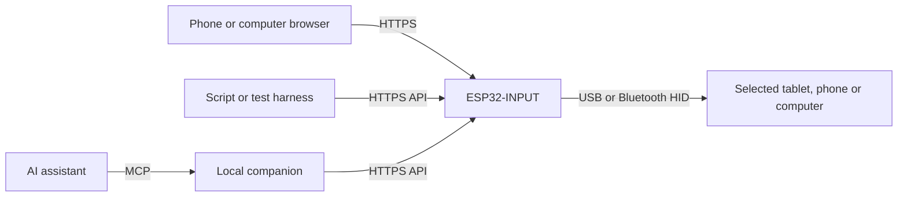

# Control another device from the web, an API or an AI assistant

ESP32-INPUT can act as a network-controlled mouse and keyboard. A controller
on the LAN sends authorized commands to Mosaico. Mosaico sends standard USB or
Bluetooth HID reports to one selected tablet, phone or computer. The target
receives ordinary input and needs no Mosaico application or LAN connection.

## Try these workflows

| Workflow | Example |
| --- | --- |
| Browser remote | Pair a phone browser, then use it as a touchpad for an unlocked tablet paired to Mosaico. Move the pointer, click or compose a short line in the browser and explicitly send it. |
| Presentation control | Keep the slide deck focused on the HID host. Use an approved client to send the app's next or previous slide key. Verify the key mapping in that app. |
| Repeatable input tests | Drive a disposable editor or a demo app with short pointer movements, key taps and sample text. Observe the actual target result alongside the command result. |
| AI-assisted control | Connect an MCP-capable AI client to the local companion. Ask it to check the selected host, perform a small named action such as typing a sample line into a focused editor, and release input control. |

See [device and host validation](validation.md) for tested combinations and
open issues.

## Browser controller

Join Mosaico to an existing LAN, commission its HTTPS identity, and open the
station address from a trusted browser. Choose **Pair this browser** and
approve the browser's fingerprint and keyboard/mouse permission on the device.
Check the selected HID host, choose **Take control**, and select Mouse or
Keyboard. Try one pointer move or send `Hello from Mosaico` to a disposable
editor. Choose **Stop** to release control. The
[browser guide](browser-controller.md) covers setup and status messages.

## HTTP API

The HTTP API runs over HTTPS on the station interface. A native client
requires enrollment with `view` and `input.control` for these examples.
Use the [companion enrollment procedure](../bridge/README.md#local-enrollment)
and its [native client](../bridge/control_bridge.py) as the session reference.

1. Authenticate through `POST /api/v1/sessions` with the enrolled native
   client ID and credential. Validate the enrolled TLS identity. Send the
   returned session token as `Authorization: Bearer <token>` and keep it out
   of URLs and logs.
2. Read `GET /api/v1/state` to check the selected target, link readiness,
   current workspace and protocol context. Acquire a short input lease
   using `control.acquire` with the current state sequence and the
   `script` producer. Confirm that the lease is active.
3. Submit a command envelope to `POST /api/v1/commands`. Use the session's
   boot ID, session ID, next sequence and request prefix, the current target,
   epoch and transport generation, and the active lease ID. Append the
   sequence as 16 lowercase hex digits to the request prefix for
   `request_id`. Compute `deadline_ms` from `protocol.now_ms`; the companion
   uses a 200 ms deadline for relative movement. After `mode.select`, refresh
   state before the next action.
4. Read `GET /api/v1/requests/{id}` using the returned command key when the
   result is pending. Stop on rejection or unknown outcome. Explicitly renew
   an active lease if needed, then call `control.release` when finished.

These examples are the `op` and `args` fields inside the
[command envelope](../api/control-command.schema.json).

| Operation | Arguments |
| --- | --- |
| `control.acquire` | `{"state_sequence":"<current sequence>","producer":"script","lifetime_ms":3000}` |
| `mode.select` | `{"mode":"mouse"}` |
| `mouse.move_relative` | `{"dx":20,"dy":0}` |
| `mouse.click` | `{"button":"left"}` |
| `mode.select` | `{"mode":"keyboard"}` |
| `keyboard.key_tap` | `{"usage":79,"modifiers":0}` for the Right Arrow key |
| `keyboard.text.enqueue` | `{"text":"Hello from Mosaico"}` |
| `control.release` | `{}` |

Pointer deltas are relative HID units. Text accepts 1–32 printable US ANSI
characters and never appends Enter. The [API reference](remote-control.md)
links the full operation catalog, scopes and results.

## AI control over MCP

Set up the [local MCP companion](../bridge/README.md#mcp-connection) with an
enrolled profile, then connect it to an MCP-capable assistant. The model runs
in the client. Mosaico runs the authenticated input and transport logic.

A first task can be as small as:

> Read the current input state and tell me the target. Once I confirm the
> target and focus a disposable editor, acquire script control, select Keyboard,
> type `Hello from Mosaico` without pressing Enter, report the device result,
> and release control.

The companion exposes `state_get`, `control_acquire`, `mode_select`,
`keyboard_text_enqueue`, `keyboard_key_tap`, `mouse_move_relative` and other
[generated tools](../bridge/tools.json). Refresh context after state changes.
The short input lease is explicit. Local takeover or lock can cancel
remote work.

The API reports device state and HID submission. To verify what happened in a
target app, observe it directly or provide a separate authorized screen
source to the model. Mosaico does not return the target's screen or current
focus. Inspect the target before retrying any action with an unknown outcome.
