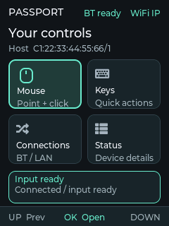
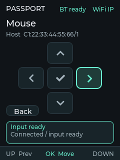
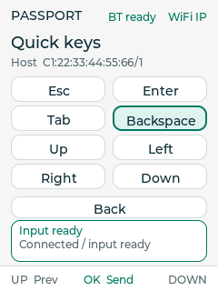
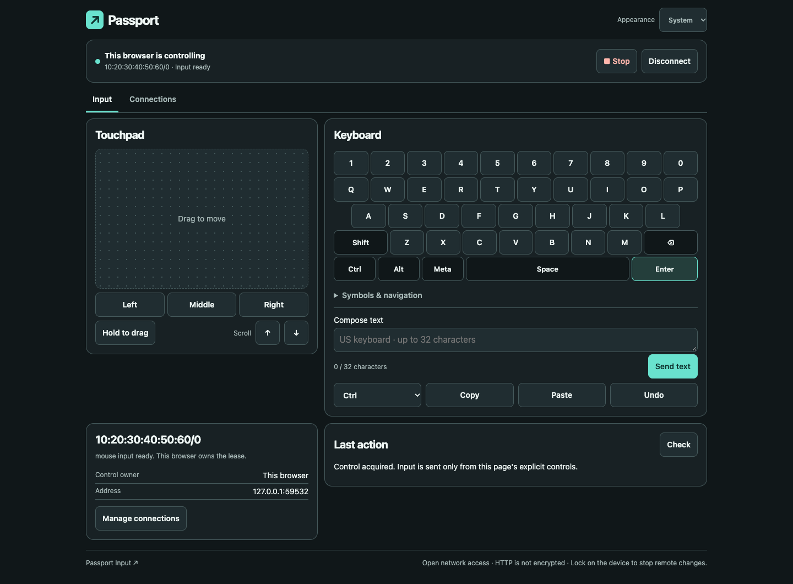
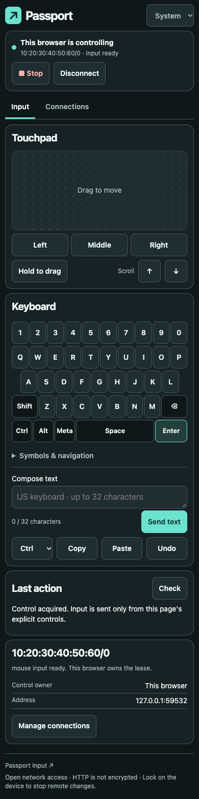

# Mosaico device UI

The native interface uses a 480 × 480 display. Each workspace gives its main
controls most of the screen. Menu opens mode selection, Status and Settings.
The physical AI button also opens Menu with a double press.

| Workspace | Design and behavior |
| --- | --- |
| [Mouse](mouse.png) | The pad occupies the center, with a separate scroll column and explicit click and drag controls. Calibrated aiming pauses during touch. |
| [Keyboard](keyboard.png) | The draft stays visible above the character grid. Confirm characters locally, then explicitly Send. Keys opens direct host actions without changing the draft. |
| [Audio](audio.png) | Mic and Speaker show independent route readiness and job state. Choosing USB or Bluetooth does not start either job. |

The renders come from the [native LVGL suite](../../tests/ui/README.md), using
the firmware UI and synthetic state. They illustrate the display layout and
do not establish device or host behavior. The [interaction contract](../interaction.md)
defines transitions, controls and safety boundaries. The
[user guide](../user-guide.md) covers operation on the device.

## Passport device and Web UI

Passport has a separate 240 × 320, three-button interface. It uses compact
cards, an always visible UP/OK/DOWN footer, and focused controls in both
palettes. The Web controller adapts to desktop and phone widths, with a combined
touchpad and QWERTY keyboard, a Connections page and its own Dark/Light/System choice.

| Home | Directional mouse | Quick keys |
| :---: | :---: | :---: |
|  |  |  |

| Desktop Web · Dark | Phone Web · Dark |
| :---: | :---: |
|  |  |

The device screens come from the production LVGL renderer. The Web screens
were captured in Chromium. Both use synthetic host data. The [Light home
screen](passport-device-light.png) shows the second on-device palette.
See the [Passport guide](../../passport/README.md) for controls and validation.
