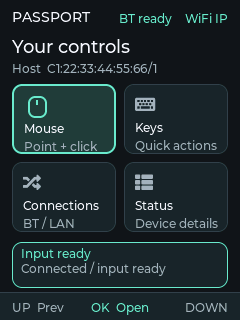
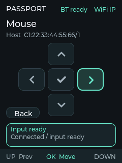
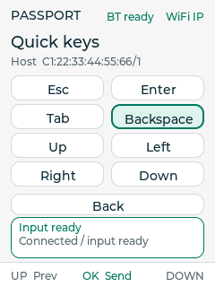
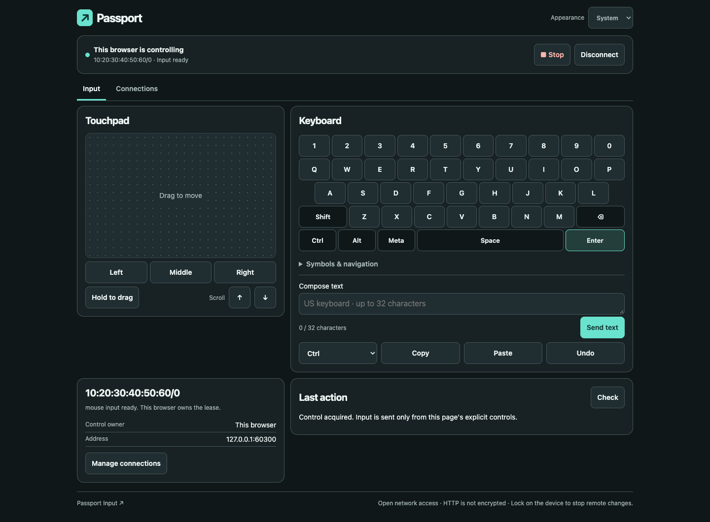
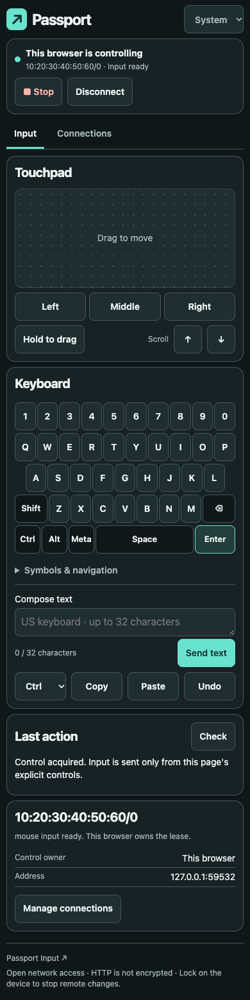

# Passport 随身键鼠

把 Passport 配对到电脑或平板，就能用机身三个按键移动光标、点击和发送常用按键。打开 Passport 自带的网页，手机也能当触控板，用屏幕键盘打字。鼠标和按键都会发往与 Passport 蓝牙配对的主机。

[下载 Passport v0.1.0](https://github.com/from1to9/ESP32-INPUT/releases/tag/passport-v0.1.0) · [English guide](README.md)

| 首页 | 方向鼠标 | 快捷键 |
| :---: | :---: | :---: |
|  |  |  |

### 第一次使用

1. 用 **UP / DOWN** 移动选中框，用 **OK** 确认。在首页进入 **Connections → Bluetooth → Pair new host**，按屏幕提示开启配对。在要控制的电脑或平板的蓝牙设置中选中 Passport。设备显示 **Input ready** 后即可发送输入。
2. 回到首页进入 **Mouse**，选择方向后按 **OK** 移动光标；选中中央的 **Click** 再按 **OK** 点击。进入 **Keys** 可以发送方向键、Esc、Enter、Tab 和 Backspace。本机按键通过蓝牙工作，无需先配置 Wi-Fi。
3. 要用手机触控板，先把手机连到 Passport 所在的网络，在浏览器打开设备屏幕显示的地址。依次点 **Connect browser → Take control**，在 **Touchpad** 上滑动，观察配对主机上的光标。页面还提供左右键、滚动、拖动和英文键盘。

| 桌面网页 · 深色 | 手机网页 · 深色 |
| :---: | :---: |
|  |  |

设备截图由固件的界面代码渲染，网页截图来自 Chromium；图中主机和网络信息为演示数据。

### 连接自己的 Wi-Fi

进入 **Connections → Wi-Fi → Use Passport Wi-Fi → Open setup**。用手机扫设备上的入网二维码，或按屏幕显示的名称和密码连接临时热点。再扫网页地址二维码打开配置页，选择自己的 2.4 GHz 网络并输入密码。核对设备屏幕上的网络名称和请求编号，选中确认并按 **OK**。连上后，让手机回到同一网络，打开设备显示的新地址。若配置窗口超时，可从 **Open setup** 重新打开。

### 停止控制与查看版本

网页的 **Stop** 会停止输入。机身长按 **DOWN** 可锁定并停止远程输入。松开所有按键，再长按 **OK** 解锁。同一网络中能访问设备地址的人都能申请控制，请在受信任的网络使用。

在首页选择 **Status** 查看实时连接状态。短按 **UP** 或 **DOWN** 切换到 **About Passport（2/2）**，可以看到开发者 `from1to9`、运行中的固件版本和 Git 提交号前八位。按 **OK** 返回。

### 选择固件

已有相同分区布局的 Passport，可用发布包内的应用镜像更新，保留配对和 Wi-Fi 设置。完整镜像用于空白设备或整机重装，刷入后会清除原设置。请按压缩包内的刷写说明选择镜像。

[网页与 API 说明](API.md) · [USB 串口控制](../docs/passport-usb-control.md) · [测试记录](../docs/validation.md)
